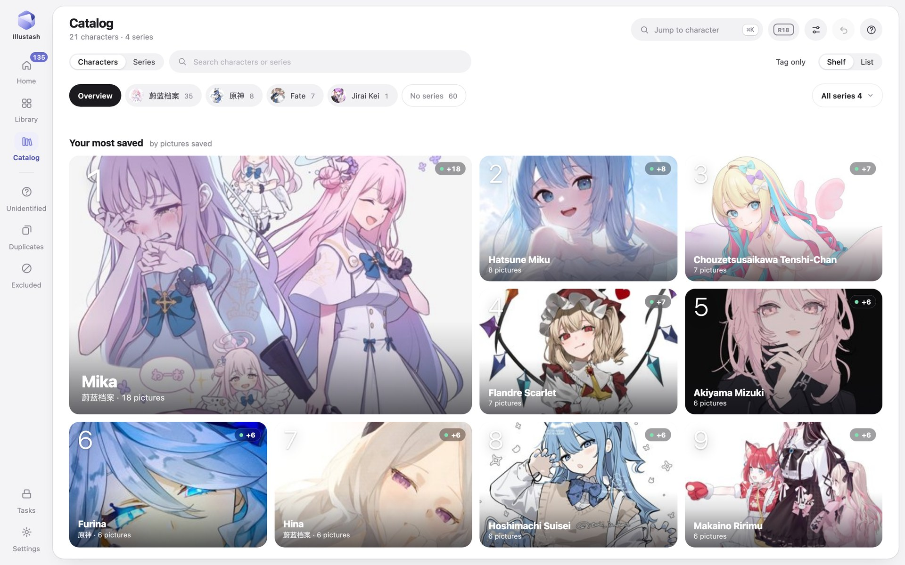
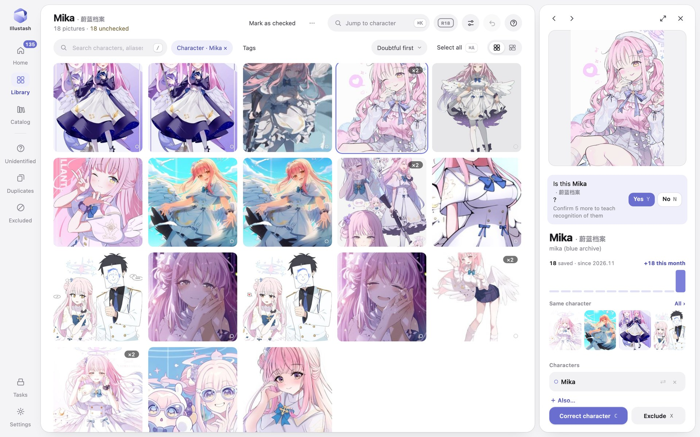
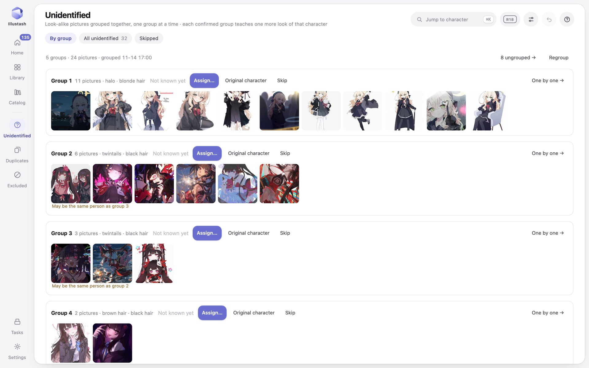
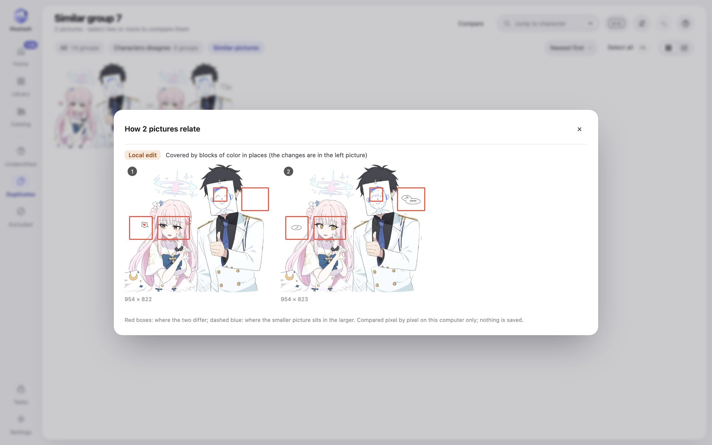
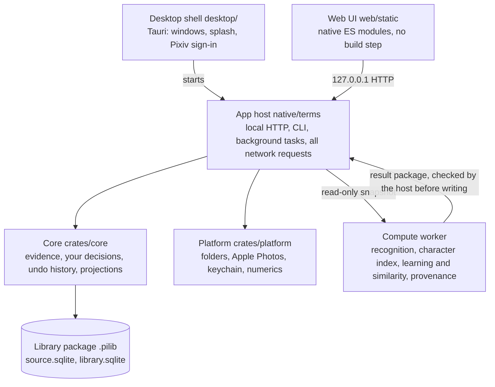

<div align="center">


# Illustash

**A local library for your anime illustration collection.**

[](https://github.com/shio-vinyl/illustash/releases/latest)
[](LICENSE)
[%20%C2%B7%20Windows%20x64-lightgrey.svg)](#download-and-status)
[](#how-it-works)

[**Download**](https://github.com/shio-vinyl/illustash/releases/latest) · [Features](#what-it-does) · [Privacy](#privacy-and-boundaries) · [How it works](#how-it-works) · [Build from source](#running-from-source)

English · [简体中文](README.zh-CN.md)

</div>



<sub>Screenshots come from a demo library picked for this purpose. The illustrations belong to their original artists; to request removal, please <a href="https://github.com/shio-vinyl/illustash/issues">open an issue</a>.</sub>

A local library tool for anime-style illustrations. It organizes thousands of pictures saved from X and Pixiv by series and character, and helps trace back their artists and original posts. Originals stay where they are; recognition and indexing run locally, and your pictures never leave your computer.

Save illustrations from X and Pixiv long enough and you easily end up with tens of thousands of pictures. Kept in a system photo app, they mix with everyday photos and screenshots because general-purpose albums do not recognize anime characters; sorting into folders by hand breaks down when multiple characters share a picture or appear in different outfits, while asset managers like Eagle require tagging and maintaining everything yourself.

Once you connect your picture sources and finish local recognition, Illustash builds a ready-to-browse catalog of series and characters. You do not need to sort tens of thousands of pictures before using it, and pending-work counts are not shown on screen by default (“Counts in the sidebar” is off by default). Browse your pictures like a photo album; when you see a misidentified character, fix it with a click and the library updates subsequent assignments around your decision.

### Highlights

- **[A ready-made catalog](#picture-sources-and-character-catalog)**: local models sort pictures into series → character → form, and group pictures appear under every character in them.
- **[Your decisions take precedence](#manual-corrections-and-local-learning)**: fix a character with a click and undo at any time; re-running recognition never overwrites what you edited.
- **[Artists and original posts, found again](#finding-artists-and-original-posts)**: pixel hashes, image signatures, and your following lists, without uploading your originals or thumbnails.
- **[Duplicates and variants, folded](#excluding-non-illustrations-grouping-duplicates-and-r18-filtering)**: re-saves, crops, censored versions, and subtle variants are compared and grouped locally.
- **[Local by default](#privacy-and-boundaries)**: recognition and indexing run on your computer, and every network feature is off by default.

## What it does

### Picture sources and character catalog

**System Photos and local folders:** Connects to macOS Photos (read-only, importing pictures saved from X and Pixiv) and local folders without moving or copying your originals. Picture sources are organized into tabs by saved origin (“Pixiv”, “X”, “Other”): macOS Photos distinguishes them automatically by the app that saved each picture, while folders are assigned an origin when added.

**Hierarchical series and character catalog:** Uses local models to identify characters in each picture and builds a “Catalog” structured as Series (with optional parent series) → Character → Form (outfit, alternate version, transformation and so on); turning on “Online name lookups” can fill in Chinese names as well. Searching by Chinese, Japanese, or English names, aliases, or raw tags finds the matching character. Group pictures appear under every character in them, and different outfits or looks stay grouped under the same character. The screenshot at the top of this page shows the Catalog.

**Creating new series and characters:** Series, characters, or original characters not yet in the catalog can be created directly without waiting for a character index update. Once you confirm 5 pictures for a character, Illustash uses their visual features to link other pictures of that character; for characters whose names you do not know yet, look-alike pictures can be grouped under “Unidentified” first and renamed or merged into a character later.

### Manual corrections and local learning

Machine recognition results apply by default, so you do not need to check every tag before browsing. When you spot a mistake while paging through pictures, you can change, remove, or merge characters with a click, and every action can be undone at any time (⌘Z / Ctrl+Z).

**Your decisions take precedence:** Any assignment you confirm or reject always overrides machine judgment. Re-running recognition or updating the character index later will never overwrite assignments you edited or re-add a wrong character you removed.



**Identifying new looks from confirmed examples:** When a picture has a fan-made outfit, a different art style, or was missed initially, confirming 5 pictures for that character lets Illustash look for their other appearances based on existing examples: high-confidence matches are assigned automatically, while uncertain ones are marked “Might also be” for you to confirm.

**Grouping obscure and original characters:** For characters whose names you do not know yet and original characters (OCs), Illustash groups look-alike pictures by appearance and traits such as hair color, eye color, and animal ears. Once you know who they are, you can assign the entire group at once without editing picture by picture.



“Home” occasionally shows a “Who's this?” card to add confirmed examples for uncertain characters or characters with few samples. For series you follow regularly, you can also turn on “Follow new characters” in the “Catalog” to fetch reference features for newly debuted characters on demand after confirming network access.

### Finding artists and original posts

For older pictures whose file names were changed and whose source posts were lost, Illustash can recover the origins of part of your illustrations in batch once you allow network access, without uploading your originals or thumbnails.

**Matching posts from multiple clues:** Combines Danbooru pixel hashes, locally computed IQDB signatures, and your Pixiv following list or an imported X data-archive following list to find original posts and restore artist names and post links.

**Finding other works by a known artist:** Once an artist is identified, you can click “Find more of their pictures” in the details panel to fetch thumbnails of their public works on Danbooru and Pixiv (matching R18 works on Pixiv requires signing in with your own account inside the desktop app). The thumbnails are compared with your library by signature on your computer only and deleted afterward, keeping only the signatures used for matching (16×16 grayscale and 24×24 color); matches show you other works by the same artist in your library.

Clicking an artist from picture details lets you filter the library by that artist and open links to their profile pages and original posts.

### Excluding non-illustrations, grouping duplicates, and R18 filtering

**Excluding non-illustrations:** Automatically distinguishes anime-style illustrations from real-life photos, chat logs, UI screenshots, and text images, placing non-illustrations under “Excluded” (rules can be toggled in Settings). A macOS Photos source only reads pictures saved from X and Pixiv, and everyday photos or clutter mixed into folders or saved files are moved to “Excluded” by the same rules.

**Grouping duplicates and variants:** Re-saved originals, versions with added or removed text, crops, color-patch or mosaic censored pictures, and subtle variants that only change an expression or glasses are compared and grouped locally. Select several pictures and click “Compare” to outline differing regions or crop positions on the pictures.



Identical and re-saved pictures fold automatically by default; subtle variants, local edits, crops, and other relations can also be set to fold in Settings. Editing character assignments on copies folded into the same duplicate group syncs automatically; if copies in a group disagree on their characters, they are held for alignment first and not folded yet.

**R18 rating and filtering:** Automatically detects picture age ratings. The “R18” button in the top bar hides R18 content (shortcut H) or switches to “R18 only”.

## Privacy and boundaries

**Pictures stay local:** Picture recognition, feature extraction, similarity matching, and library indexing all run on your computer. Originals and features computed from them are never uploaded to the cloud, never sent to any LLM or multimodal API, and never used to train or improve any shared model (including the recognition models used by this app). Scoring rules learned locally from your labels (such as character prototypes and custom tag candidates) are saved only in the current library and disappear if the library is deleted.

**Originals stay untouched:** Building a library does not copy picture files, delete or modify original files, or directly modify the Apple Photos database. Illustash only builds its own index, so your existing folders or albums can be used as usual.

**Network access requires your permission:** Every network feature is off by default. Looking up Chinese character names and searching Danbooru tag data send only text such as tag names and series names (when assigning a character to a picture, Danbooru candidates fetch one small all-ages preview picture by tag); you can grant permission once for the current library and revoke it at any time.

- “Find artists” and “New characters” each require separate confirmation before every run.
- Recognition models are fetched online only when you click download (or can be imported offline from files).
- Update checks periodically query the GitHub release list only after you actively turn them on (sending no library data), and can be run manually in “Settings › About” when off; a new version is downloaded from GitHub only when you click “Download and restart”, and is installed after its signature is verified.
- “Network and privacy” in Settings lists every network feature and the data it sends; saving an account or changing startup preferences does not grant network access.
- Microsoft's ONNX Runtime, which recognition uses, has telemetry on by default in its official releases; Illustash turns it off in every recognition process, so it does not go online.
- On Windows, the Microsoft DirectML component used for GPU-accelerated recognition is registered with the system's telemetry channel and may, under its license, send usage data to Microsoft according to your system's “Diagnostic data” settings; if you prefer not to use it, turn off “Use the GPU to speed up recognition” in “Settings › Data › Recognition models” (switching to CPU only without loading the component), as detailed in [Troubleshooting installation and launch](docs/INSTALL.md#windows) (in Chinese).

**Third-party site access:** External services such as Pixiv, X, Danbooru, and IQDB are all optional. When an account is needed, Illustash uses your own account with read-only, low-frequency access; if it encounters a CAPTCHA or rate limit, it stops and does not attempt to bypass it. Illustash was not created or distributed by pixiv and is not affiliated with pixiv, X, Danbooru, or any other site.

## Download and status

> [!NOTE]
> Illustash is a personal project built primarily for the author's own needs and is still in early development.

Illustash has been officially released since 0.1.0. Download the latest version from [GitHub Releases](https://github.com/shio-vinyl/illustash/releases): a zip for Apple silicon Macs and an x64 installer for Windows. The installers are not notarized by Apple or code-signed for Windows, so the system blocks them the first time you open them; allow them once as described in [Troubleshooting installation and launch](docs/INSTALL.md) (in Chinese). When a new version comes out, you can check for updates and use “Download and restart” inside the app.

| Platform | Status | Download |
|---|---|---|
| macOS 14 or later, Apple silicon | Primary platform | zip |
| Windows x64 | Also usable | x64 installer |
| Linux | Frozen (decided 2026-10-06) | Not provided |

Linux is frozen: no installers or local computation (recognition, indexing, learning, origin lookup) are provided, no checks are run on Linux, and Rust code is not guaranteed to compile on Linux; if needed later, support will be built on top of the native macOS/Windows implementation.

The interface supports Simplified Chinese and English, defaults to “System”, and can be switched in “Settings › General › Language”.

You can also build from source. The core uses Rust stable; Python is not needed at runtime, while some build and check tools require Python 3.12 and Node 22.

Model files required for local recognition are not included in the code repository or the installers (the app downloads them when prompted on first use, or imports them offline from files; running from source requires preparing them separately). See [Installation and platforms](docs/BACKEND_TASKS.md#独立安装与可选计算包) for dependencies, build steps, and compute component setup, and [Troubleshooting installation and launch](docs/INSTALL.md) for common gatekeeping prompts, model downloads, and runtime troubleshooting.

### Running from source

```sh
# Build the core
cargo build --release --manifest-path native/terms/Cargo.toml

# Create a library for the first time: registers sources only, without scanning pictures
./native/terms/target/release/illustash-terms library-create \
    --dest ~/Pictures/Illustash/MyLibrary.pilib --folder /path/to/pictures

# Open (defaults to http://127.0.0.1:8765)
./start-web.command --library ~/Pictures/Illustash/MyLibrary.pilib
```

Creating a library for the first time only registers picture sources and does not immediately scan all pictures. For the desktop app (Tauri), installer builds, launch options, and library package layout, see [Development guide](docs/DEVELOPMENT.md).

## How it works

This section is for developers and curious users who want to know how Illustash does what it does: the techniques behind each feature and the trade-offs we made. The details and evidence live in the reference documents under `docs/` (in Chinese), linked at the end of each part.

### Architecture



Illustash is a modular monolith written in Rust. All data lives in SQLite, and no Python is needed at runtime.

- **Core** (`crates/core`) owns the business rules: terms, machine evidence, your decisions, undo history, and what each picture ends up showing as a result. It has no idea which platform it runs on. `crates/iqdb` computes IQDB image signatures locally.
- **Platform** (`crates/platform`) keeps macOS and Windows differences out of the core: walking folders, read-only access to Apple Photos, native file pickers, account credentials in the Keychain or DPAPI, and Accelerate / OpenBLAS numerics.
- **App host** (`native/terms`) creates, opens, upgrades, and backs up libraries, serves HTTP on 127.0.0.1 only, and schedules background tasks. Every network request leaves from here.
- **Compute worker** is one native program that handles recognition, the character index, learning, similarity scans, and provenance computation. The host hands it a read-only snapshot or an isolated directory; the worker returns results, and the host checks their identity, input fingerprints, and scope before writing anything. If the worker is missing or crashes, browsing, organizing, and undo keep working.
- **Web UI** (`web/static`) uses the browser's native ES modules with no bundler. Modules under `core/` never touch the DOM, so they can be tested directly in Node.
- **Desktop shell** (`desktop/`) is a Tauri app that only launches the host, manages windows, and hosts the Pixiv sign-in window. It contains no business logic.

See [Architecture](docs/ARCHITECTURE_DIRECTION.md), [Development guide](docs/DEVELOPMENT.md), and [Front-end modules](docs/WEB_V2.md#前端模块2026-10-18199).

The parts below are collapsed; click a title to expand it.

<details>
<summary><strong>Character recognition</strong>: two local models, then learning from the pictures you confirm</summary>

Every new picture goes through two models on your computer. [WD SwinV2 Tagger v3](https://huggingface.co/SmilingWolf/wd-swinv2-tagger-v3) produces general tags, an age rating, and tags for about 2,700 well-known characters. [CCIP](https://huggingface.co/deepghs/ccip) produces a 768-dimensional character feature: the same character lands close together whoever drew them and whatever they wear. The CCIP feature is matched against reference features (anchors) in the character index by nearest neighbor, and a match within the threshold counts as evidence. The two sources are recorded separately and ranked by strength, calibrated against your own decisions: agreement between both is strongest, then a single strong match, then weak ones. This ranking decides who a solo picture belongs to. The base character index, built from the fixed [Character Index](https://huggingface.co/datasets/deepghs/character_index) release with anchors for about 7,400 characters, is downloaded together with the recognition models instead of shipping in the installer. “Follow new characters” and “New characters” in the Catalog download public reference images from Danbooru by tag and build anchors locally; nothing from your library is uploaded.

Once you confirm 5 pictures of a character, Illustash learns two things from them locally. The first is **prototypes**: confirmed pictures are clustered by density into up to 8 groups, one per look such as everyday clothes or a swimsuit. Each prototype claims pictures within the 90th percentile of its members' distances, and always closer than any picture you removed from that character. The second is a **discriminative claim**: each character gets a logistic regression trained against negatives that include the pictures you removed and the confirmed pictures of other characters. A picture is claimed automatically only when the probability is high, it sits close to one of the confirmed pictures, and it is closer to them than to anything you removed. Matches just outside these ranges are kept as hints for “Might also be” and never count as assignments. Everything learned stays in the current library and is relearned in batches after you confirm, remove, or undo.

Characters nobody can name yet are clustered by CCIP feature density. WD's appearance tags (hair color merged into color families, plus eye color, animal ears, halos, wings, and so on) are used to split a group that mixes two hair colors and to suggest when two groups “might be the same character”.

Inference runs on ONNX Runtime. On Apple silicon, WD and CCIP use Core ML, with WD running an equivalent rewritten variant of the model with fixed shapes; on Windows both use DirectML. The CPU is the reference: if an accelerated session cannot be created or its output fails validation, that picture is recomputed on the CPU. On the acceptance samples, accelerated results differ from the CPU only by fp32 rounding and no decision changes. The model identity recorded in the database always comes from the original model file. Before decoding, the worker checks each picture against the SHA-256 the host gave it, so every result is tied to the exact bytes that were recognized.

See [Characters and outfits](docs/TERMS_CHARACTERS.md), [Recognition result packages](docs/RESULT_PACKAGES.md), [Recognition backends](docs/BACKEND_TASKS.md#识别的执行后端), and [New-character flow](docs/WEB_V2.md#新角色流程相似分组与边标边学2026-09-24).

</details>

<details>
<summary><strong>Your decisions come first</strong>: machine evidence and your decisions are stored apart, with one undo for everything</summary>

In the core, characters, series, artists, ratings, and custom tags are all **terms**, and putting a term on a picture follows the same rules whether a model or you did it. Machine evidence is only ever added, never deleted, and no source overwrites another. Decisions come only from people, and a “no” is permanent. Whether a picture shows a term as confirmed by you, assigned by the machine, “might also be”, or rejected is recomputed every time from the evidence, the decisions, and the policy for that kind of term.

The two kinds of data are stored apart. A worker can hand over machine evidence only as an evidence or recognition result package, and a package containing any human source is rejected whole, so compute code is structurally unable to write your decisions. Re-running recognition or updating the character index replaces only older machine evidence in the same scope and leaves your decisions untouched. A character you removed is never put back by the next batch of evidence.

Every manual action runs in one write transaction: resolving the selection, validating it, writing, and recording one history step. If anything fails, the whole step rolls back, so nothing is ever half written. There is a single undo mechanism: it reverts the latest step across the whole library, whether that step changed characters, tags, artists, or inclusion, and it still works after a restart. Derived tables maintained by the core are write-protected, so a write that bypasses the core fails loudly instead of slipping through.

See [Terms](docs/TERMS.md#2-核心抽象词条), [Evidence packages](docs/EVIDENCE_PACKAGES.md), and [Assignment rules and API](docs/WEB_V2.md#归属规则).

</details>

<details>
<summary><strong>Finding origins</strong>: several clues propose candidates, and every candidate is verified locally</summary>

Provenance follows a “seeds plus verification” design: several clues each propose candidate artists or match original posts outright, and every candidate then goes through the same local verification.

- **Danbooru pixel hash**: the picture is decoded to raw sRGB-plus-alpha pixels and hashed with MD5, the same algorithm Danbooru uses, so metadata rewritten by the app that saved the picture does not matter. Only the hash is sent; a hit means identical pixels, so it cannot be wrong.
- **IQDB signature**: `crates/iqdb` computes IQDB's perceptual signature locally and only the signature text is sent, which finds the same picture after resizing or recompression. The queue is ordered by each source's and rating's past hit rate, so the most promising pictures go first.
- **Following lists**: Pixiv reads your following list read-only with the account you signed in with inside the app; for X, you import the official data archive and only the numeric account IDs in `following.js` are read, offline. People you follow become candidate artists.
- **Local verification**: small thumbnails of a candidate artist's latest public works on Danbooru and Pixiv are downloaded and compared on your computer with 16×16 signatures, then double-checked with 24×24 color thumbnails. Only a match counts; the thumbnails are deleted afterward and only these two signatures are kept.
- **Group inheritance**: once one picture in a duplicate or similar group has an artist, the whole group shares it; pictures saved in one continuous stretch are offered only as candidates for you to confirm.

Never uploading originals is a hard line, and it has a cost: with only hashes and signatures, what can be recovered is mostly work that was reposted to Danbooru. On the author's own library (about 50,000 pictures), the pixel hash alone recovers about a fifth of X pictures but only about 6% of Pixiv pictures. Once an artist is known, “Find more of their pictures” extends the reach through local verification. Your “this is / isn't them” is a decision in the core and can be undone like anything else. Provenance writes only to its own `provenance.sqlite` and never touches your decisions.

See [Provenance](docs/PROVENANCE.md); section 8 describes the current pipeline.

</details>

<details>
<summary><strong>Duplicates and variants</strong>: signatures, candidate pairs, then a pixel-level relation check</summary>

Byte-identical copies are grouped by file hash. The broader similarity scan runs locally in three steps:

1. **Signatures**: each picture is decoded once to store its canvas aspect ratio and a 16×16 grayscale thumbnail.
2. **Candidate pairs**: pictures with the same aspect ratio and highly correlated thumbnails, up to the 12 closest per picture, plus pairs with nearly identical CCIP features to catch crops. Pairs already compared are skipped.
3. **Relation check**: each pair is compared pixel by pixel, without any model. Both are scaled to the same size, compared with one pixel of misalignment tolerated, and aligned coarse to fine; the size, position, and statistics of the changed region then classify the pair as duplicate, color adjustment, text or border at the edges, color-patch or mosaic censoring, variant, subtle variant (under 2% of the area changed), similar composition, or unrelated. When aspect ratios differ, multi-scale FFT normalized cross-correlation looks for one picture inside the other to detect crops.

Every result is stored, including “unrelated”. A union-find then joins byte-identical copies and the relations you chose to fold in Settings into groups, and the highest-resolution picture represents each group. Groups whose pictures disagree on characters stay unfolded until you align them. Editing any picture in a group applies to the whole group in the same transaction.

See [Relation check](docs/WEB_V2.md#图片关系判断2026-09-24) and [Library-wide similarity](docs/WEB_V2.md#全库找相似2026-09-24).

</details>

<details>
<summary><strong>Library packages</strong>: what is inside a <code>.pilib</code> folder and what is safe to delete</summary>

A library is a `.pilib` folder:

| Item | What it holds | Safe to delete? |
|---|---|---|
| `library.json` | Name, permanent ID, sources, package format version | No |
| `library.sqlite` | Your decisions, machine evidence, undo history, and derived tables | **No**, it is not a cache; if it is damaged, restore a backup (below) |
| `source.sqlite` | Snapshot of your sources and recognition results (tags, features) | Don't. Recognition can be redone, but folder pictures get their IDs on the first scan and your decisions are linked to them; if it is damaged, the in-app rescue keeps those IDs |
| `provenance.sqlite` | Provenance lookup cache and machine results | Not included in exports |
| `thumbnails/` | Thumbnail cache | Any time; it is rebuilt |
| `library-backups/` | Required pre-upgrade SQLite copies | Keep for rollback |
| `backups/` | Manual SQLite backups and damaged-source evidence | Up to you |
| `backups/human-conclusions/` | Automatic snapshots of current human decisions | Retains 30 successful snapshots |

The `format` field in `library.json` is the package format version, separate from each database's own schema version. A format newer than the program is refused outright rather than guessed at. Opening an older library never upgrades it silently: you confirm first, `library.sqlite` is backed up into `library-backups/` with SQLite's backup API, and the migration runs in a single transaction, leaving the library as it was if it does not finish. A library that was not closed cleanly gets a full integrity check of both databases before it opens. An exported `.pilib.zip` holds only the configuration, the two databases, and the features, with secrets such as API keys cleared, so it is safe to share.

If `library.sqlite` is damaged, Illustash stops writing and explains how to restore it: quit, move `library.sqlite` with its `-wal` and `-shm` files out of the library folder, copy a backup back in as `library.sqlite`, and open the library again. Use either a `library-*.sqlite` from `backups/` (not the `source-damaged-*` files there), or a copy from `library-backups/`, which predates an upgrade, so Illustash asks to upgrade it again. Pick the most recently modified; curation done after it is lost.

The host creates a human-decision snapshot after a successful library open, coalesces edits for 60 seconds, and leaves at least one hour between successful automatic files. Identical state is not duplicated; 30 files do not mean 30 days. These snapshots share the library’s storage. Manual portable export writes an independent file to Downloads; the interface is provided by the backend, with UI entry points handled separately. Restoration fills undecided items using verified exact file content, without guessing among duplicate images. Missing hashes and unsupported dependencies remain explicit in the report; portable state does not include the full undo history. See [snapshot boundaries](docs/LIBRARIES.md#人工结论快照).

See [Libraries](docs/LIBRARIES.md#1-图库包里有什么) and [Upgrade boundary](docs/ARCHITECTURE_DIRECTION.md#已有核心库的显式升级边界).

</details>

<details>
<summary><strong>How privacy is enforced</strong>: offline computation, per-feature permission, and a guarded local server</summary>

- **Computation stays offline**: recognition, indexing, learning, and similarity scans run on snapshots or isolated directories prepared by the host. The public thumbnails provenance needs are fetched by the host, subject to a site allowlist, authorization, rate limits, and a traffic cap, and then passed to the worker.
- **Permission per feature**: name lookups are authorized once per library and can be revoked at any time; “Find artists” and “New characters” ask before every run; on-demand lookups are authorized for that one click. On a 403, a 429, a CAPTCHA, or a maintenance page, requests to that site stop immediately with no attempt to get around it. “Settings › Network and privacy” lists every network feature in one table, with the service it talks to and exactly what it sends.
- **LLMs only ever see text**: pictures and features computed from them are never sent to any LLM. The only LLM-related feature is the optional name translation: when Bangumi has no Chinese name, a model you configure yourself through an OpenAI-compatible API translates it, receiving only the tag, the Japanese name, and the series name. Without a configured model, it is not used.
- **ONNX Runtime telemetry is off**: official builds have telemetry on by default. The host sets `ORT_DISABLE_TELEMETRY=1` for every worker it starts, the worker sets it again at startup, and the runtime library refuses to load if the value is not right. On Windows, telemetry events are also disabled per session, and packaging checks that the DLL is not wired into Microsoft's telemetry channel. For DirectML, see “Privacy and boundaries” above.
- **The local server is guarded too**: 127.0.0.1 is open to every process on the machine, so every request needs a session cookie, which can only be obtained with a one-time code generated at launch; write requests also need a CSRF token. Account credentials are stored in the macOS Keychain or with Windows DPAPI, never in plain text.

See [Product baseline](docs/BACKLOG.md#产品底线与已定的约束新会话先读), [Third-party components](docs/THIRD_PARTY.md#打包时加入的运行库), and [Launch signal and session cookie](docs/ARCHITECTURE_DIRECTION.md#启动信号与会话-cookie).

</details>

## Feedback and contributing

Feature trade-offs prioritize the author's own usage needs.

- **Bug reports** are welcome via Issues using the [Bug report template](.github/ISSUE_TEMPLATE/bug_report.md), along with your OS, the output of “Settings › About › Copy diagnostics”, and steps to reproduce (please do not post real pictures, picture file names, local paths, or account details); if the app fails to install or open, check [Troubleshooting installation and launch](docs/INSTALL.md) first.
- **Feature suggestions** can be submitted with the [Feature request template](.github/ISSUE_TEMPLATE/feature_request.md), though adoption or implementation is not guaranteed.
- **Code contributions** (Pull Requests) are not accepted at this time.

## License

Illustash's source code is released under the [GPL-3.0-or-later](LICENSE) license, with an additional permission under GPLv3 section 7 allowing this program to be distributed and run together with GPU inference runtime libraries such as Microsoft DirectML; see [Additional permission](docs/THIRD_PARTY.md#附加许可gplv3-第-7-条) for the full text.

Third-party components, models, and data follow their respective licenses; see [Third-party components and licenses](docs/THIRD_PARTY.md) for details. Recognition models, character indexes, and other data—whether bundled or prepared separately—are not uniformly covered by this project's code license. The CCIP model used for recognition (not included in the repository or release installers; downloaded from upstream on first use or prepared separately) is provided under the BigScience Open RAIL-M license, and its use and redistribution are bound by the use restrictions in paragraph 5 and Attachment A.

The Illustash name and icon are not licensed along with the code. Modified versions based on this project must use a different name and icon.

## Credits

Character and picture recognition use [SmilingWolf's WD Tagger](https://huggingface.co/SmilingWolf/wd-swinv2-tagger-v3), [DeepGHS's CCIP](https://huggingface.co/deepghs/ccip), and [Character Index](https://huggingface.co/datasets/deepghs/character_index); tag and character data come from [Danbooru](https://danbooru.donmai.us), and Chinese character names come from [Bangumi](https://bgm.tv).

---

<sub>Keywords: anime illustration manager · image library · photo organizer · character recognition · anime character tagging · reverse image search · Pixiv · X (Twitter) · Danbooru · IQDB · duplicate image finder · local-first · privacy · offline · Tauri · Rust · SQLite · ONNX Runtime · macOS · Windows · 二次元插画 · 插画收藏 · 本地图库 · 角色识别 · 以图搜源 · 找画师</sub>
