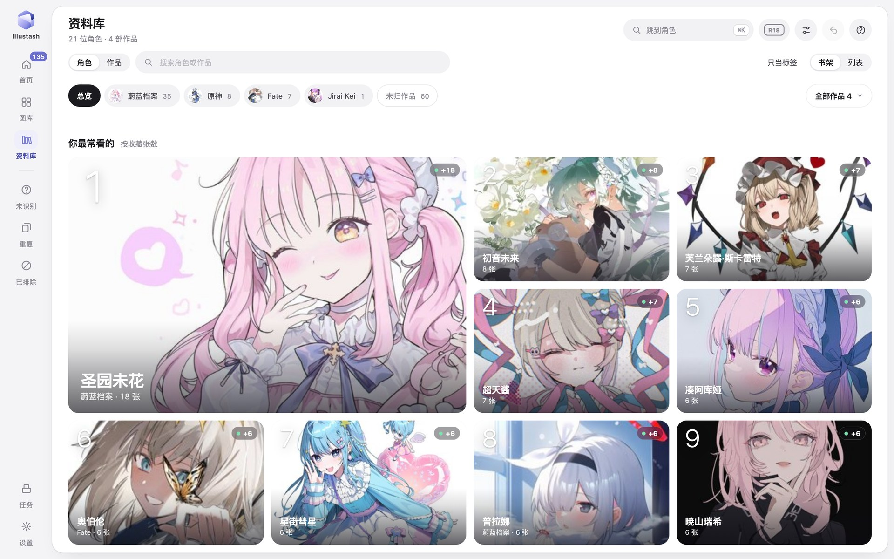
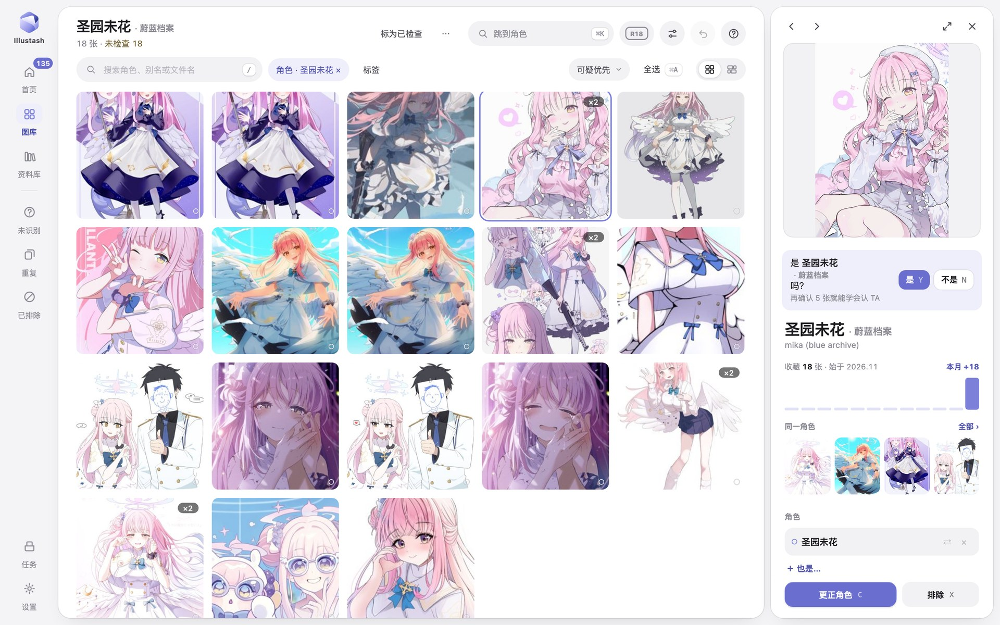
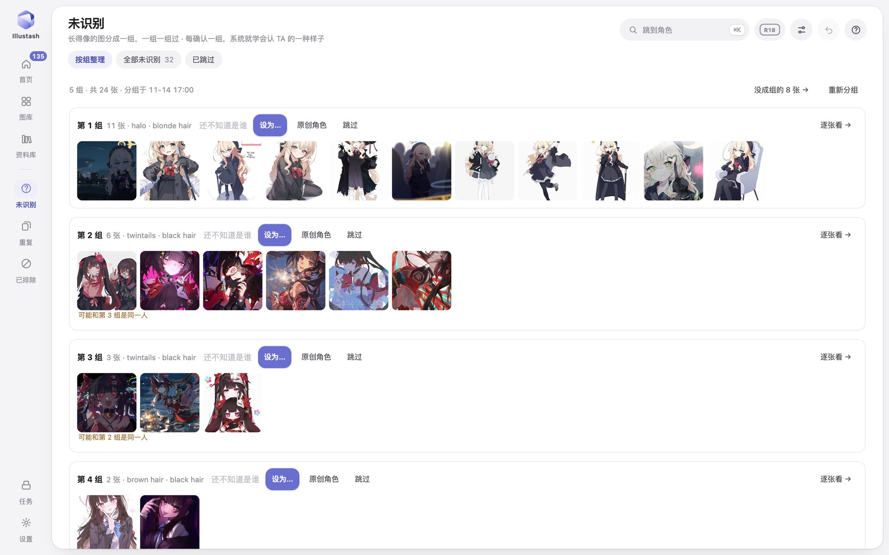
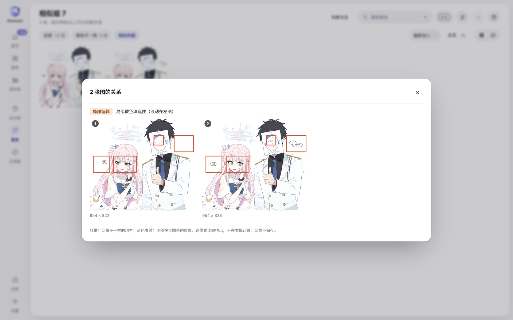
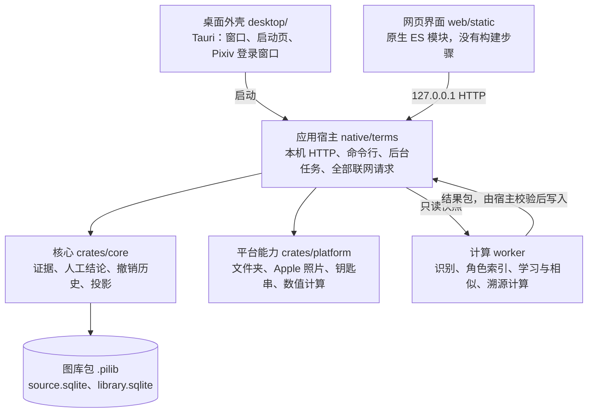

<div align="center">


# Illustash

**面向二次元插画收藏的本地图库。**

[](https://github.com/shio-vinyl/illustash/releases/latest)
[](https://github.com/shio-vinyl/illustash/actions/workflows/ci.yml)
[](LICENSE)
[%20%C2%B7%20Windows%20x64-lightgrey.svg)](#下载与现状)

[**下载**](https://github.com/shio-vinyl/illustash/releases/latest) · [能做什么](#能做什么) · [隐私](#隐私与底线) · [工作原理](#工作原理) · [从源码运行](#从源码运行)

[English](README.md) · 简体中文

</div>



<sub>截图来自专门挑的演示图库，里面的插画版权归原作者，如需移除请<a href="https://github.com/shio-vinyl/illustash/issues">开 Issue</a>。</sub>

面向二次元插画收藏的本地图库工具，用来把从 X、Pixiv 存下的成千上万张插画按作品和角色归类，并协助找回画师与原帖出处。不搬运原图，识别与索引都在本机运行，图片不出你的电脑。

从 X、Pixiv 存图久了，手头很容易攒下几万张插画。留在系统相册里，通用相册不认识二次元角色，插画会和日常照片、截图混在一起；手动建文件夹很难处理多角色同框和不同造型，而用 Eagle 这类素材库又得自己打标签、维护仓库。

接入图片来源、跑完本地识别后，就有现成的作品与角色目录。不用先把几万张图整理完才能开始使用，界面上默认也不显示「待整理数字」（侧栏计数默认关闭）。平时像翻相册一样浏览，看到哪张认错了点一下改掉，图库会按你的判断更新后续归属。

### 亮点

- **[现成的角色目录](#图片来源与角色目录)**：本地模型把插画归入「作品 → 角色 → 皮肤」，多人同框的图同时归入各自的角色。
- **[人工结论优先](#人工纠错与本地学习)**：认错了点一下改掉，随时可以撤销；重新识别不会覆盖你改好的归属。
- **[找回画师与原帖](#找回画师与原帖出处)**：靠像素哈希、图像签名和你的关注列表，不上传原图或缩略图。
- **[重复与差分归组](#杂图排除重复归组与-r18-筛选)**：重复保存、裁剪、打码和细微差分都在本地比对、归组。
- **[默认不联网](#隐私与底线)**：识别与索引都在本机运行，所有联网功能默认关闭。

## 能做什么

### 图片来源与角色目录

**读取系统相册与本地文件夹：** 支持接入 macOS「照片」（只读，导入从 X、Pixiv 存下的图）和本地文件夹，不用搬运或复制原图。图片来源可按保存出处（Pixiv、X、其他）分栏管理：macOS「照片」按存图应用自动区分，文件夹在添加时指定出处。

**作品与角色层级目录：** 用本地模型自动识别画面中的角色，按「作品（可按系列分层） → 角色 → 皮肤 / 子标签（服装、异格、另一形态）」建立资料库目录；开启名称联网查询后可补全中文名。搜索中文、日文、英文名、别名或原始 tag，都能找到对应角色。多人同框的插画会同时归入各自的角色目录，同一角色的不同服装与造型也归在一起。本页开头的截图就是资料库。

**新建作品与角色：** 资料库里还没有的作品、角色或原创角色可以直接新建，不必等待角色索引更新。给一个角色确认满 5 张图后，Illustash 会根据画面中的角色特征把后续出现的同角色插画关联起来；暂时叫不出名字的角色，也能先在「未识别」里按相似外观归成一组，之后再改名或合并到具体角色。

### 人工纠错与本地学习

机器识别的结果默认生效，不需要先检查完所有标签才能开始浏览。翻图时看到认错的，点一下就能更换、移出或合并角色，所有操作随时可以撤销（⌘Z / Ctrl+Z）。

**人工结论优先：** 你确认或否定过的归属始终优先于机器判断。后续重新识别、更新角色索引，都不会覆盖你改好的归属，也不会把已移出的错误角色重新加回。



**根据确认样本识别新造型：** 遇到同人服装、画风变化，或一开始漏认的图片，只要给该角色确认满 5 张图，Illustash 就会根据已有样本寻找这个角色的其他造型：把握高的自动认领进来，拿不准的标成「也可能是」供你确认。

**冷门角色与原创角色成组整理：** 对于暂时叫不出名字的角色和原创角色（OC），Illustash 会根据外貌以及发色、瞳色、兽耳等特征，把相似图片聚成小组。确定是谁后可以整组认领，不需要逐张修改。



首页偶尔会出现一张「认一认」卡片，用来给机器拿不准或样本较少的角色补足确认样本。常看的作品也可以在资料库里开启「关注新角色」，经你确认联网后按需补充新登场角色的参考特征。

### 找回画师与原帖出处

对于保存已久、改过文件名、找不到原帖的图片，Illustash 可以在不上传原图或缩略图的前提下，经你授权联网后批量找回一部分插画的出处。

**多线索匹配原帖：** 结合 Danbooru 像素哈希、本地计算的 IQDB 图像签名，以及你的 Pixiv 关注列表或导入的 X 数据归档关注列表，查找图片的原始出处，补回画师信息与原帖链接。

**按已知画师查找其他作品：** 认出某位画师后，可以在详情面板点「找 TA 的其他图」，拉取这位画师在 Danbooru、Pixiv 上的公开作品缩略图（Pixiv 的 R18 作品需在桌面 App 内登录你自己的账号），只在本机比对签名；缩略图比完就删，只留比对用的签名（16×16 灰度和 24×24 彩色），把图库里出自同一位画师的其他作品找出来。

从图片详情点进画师，可以在图库里按这位画师筛选浏览，并打开其主页与原帖链接。

### 杂图排除、重复归组与 R18 筛选

**排除非插画内容：** 自动区分二次元插画与三次元真人照片、聊天记录、界面截图、纯文字图等内容，把非插画图片归入「已排除」（规则可在设置中开关）。macOS「照片」来源只读取从 X、Pixiv 存下的图，文件夹或存图里混进的日常照片与杂图，也会按同样的规则自动归入「已排除」。

**重复与差分归组：** 重复保存的原图、加字或去字版、裁剪版、色块或马赛克打码图，以及只改了表情或眼镜的细微差分，都能在本地自动比对、归组。选中几张图点「判断关系」，可以在图片上框出差异区域或裁剪位置。



完全相同与重复保存的图片默认自动折叠；细微差分、局部编辑、裁剪等关系也可以在设置中按需勾选折叠。折叠进同一重复组的副本，修改角色归属时会自动同步；组内角色不一致时会先留作待对齐，暂不折叠。

**R18 分级与筛选：** 自动识别图片年龄分级，顶栏「R18」按钮可隐藏 R18 内容（快捷键 H），也可以切换为「只看 R18」。

## 隐私与底线

**图片只留本地：** 图像识别、特征提取、相似度比对与图库索引都在本机完成。原图和从图片算出的特征不会上传云端，不会发给任何大模型或多模态 API，也不会用于训练或改进任何共享模型（包括本软件使用的识别模型）。根据你的标注在本机学出的打分规则（如角色原型、自建标签候选）只保存在当前图库里，删除图库即一并消失。

**不动你的原图：** 建库时不复制图片文件，不删除或修改原始文件，也不会直接修改 Apple「照片」数据库。Illustash 只建立自己的索引，你原有的文件夹或相册可以照常使用。

**联网需你授权：** 所有联网功能默认关闭。查询角色中文名与搜索 Danbooru 标签资料，只发送 tag 名、作品名等文字信息（给图片设角色时，Danbooru 候选会按 tag 拉取一张全年龄预览小图）；你可以对当前图库授权一次，并随时撤销。

- 「找回画师」「检查新角色」每次运行前都需要单独确认。
- 识别模型只在你点击下载时联网获取（也可离线导入文件）。
- 检查更新需你主动开启后才会定期查询 GitHub 版本列表（不发送图库信息），关闭时可在「设置 › 关于」手动检查；有新版本时，只有你点「下载并重启」才会从 GitHub 下载新版本，校验签名后安装。
- 设置中的「网络与隐私」会列出全部联网功能及其发送的数据；保存账号、修改启动偏好，都不意味着授权联网。
- 识别用的微软 ONNX Runtime 在官方发布的版本里默认开启遥测，Illustash 在每个识别进程里都把它关掉，不联网。
- Windows 上用于 GPU 加速识别的微软 DirectML 组件登记在系统的遥测通道里，按其许可可能依照系统的「诊断数据」设置向微软发送使用信息；不想使用时可在「设置 › 数据 › 识别模型」中关闭「使用 GPU 加速识别」（改为仅用 CPU、不加载该组件），详见 [装不上、打不开怎么办](docs/INSTALL.md#windows)。

**第三方站点访问：** Pixiv、X、Danbooru、IQDB 等外部服务均为可选功能。需要账号时使用你自己的账号，访问以只读、低频为原则；遇到人机验证或限流就停止，不尝试绕过。Illustash 不是 pixiv 开发或分发的应用，和 pixiv、X、Danbooru 等站点都没有关联。

## 下载与现状

> [!NOTE]
> Illustash 是一个主要满足作者自己需求的个人项目，目前仍处于早期开发阶段。

Illustash 0.1.0 已正式发布，安装包在 [GitHub Releases](https://github.com/shio-vinyl/illustash/releases) 下载：macOS 版是 Apple 芯片的 zip，Windows 版是 x64 安装程序。安装包没有经过 Apple 公证或 Windows 代码签名，第一次打开时系统会拦截，按 [装不上、打不开怎么办](docs/INSTALL.md) 放行一次即可。以后有新版本时，可以在应用里检查更新并「下载并重启」。

| 平台 | 状态 | 安装包 |
|---|---|---|
| macOS 14 及以上，Apple 芯片 | 主力平台 | zip |
| Windows x64 | 也可以使用 | x64 安装程序 |
| Linux | 已冻结（2026-10-06 决定） | 不提供 |

Linux 已冻结：不提供安装包和本地计算（识别、索引、学习、溯源），不在 Linux 上做检查，Rust 代码能否在 Linux 编译也不作保证；以后有需求再基于 macOS/Windows 的原生实现补做。

界面支持简体中文和英文，默认跟随系统，可在「设置 › 通用 › 语言」中切换。

也可以从源码构建。核心使用 Rust stable；运行时无需 Python，部分构建与检查工具需要 Python 3.12 和 Node 22。

本地识别所需的模型文件不包含在代码仓库和安装包中（应用首次使用时按提示下载，或从文件离线导入；源码运行需另外准备）。具体依赖、构建方法与计算组件配置见 [安装与平台](docs/BACKEND_TASKS.md#独立安装与可选计算包)，常见拦截、模型下载与运行排障见 [装不上、打不开怎么办](docs/INSTALL.md)。

### 从源码运行

```sh
# 构建核心
cargo build --release --manifest-path native/terms/Cargo.toml

# 首次建库：只登记来源，不扫描图片
./native/terms/target/release/illustash-terms library-create \
    --dest ~/Pictures/Illustash/我的图库.pilib --folder /图片目录

# 打开（默认 http://127.0.0.1:8765）
./start-web.command --library ~/Pictures/Illustash/我的图库.pilib
```

首次创建图库只会登记图片来源，不会立刻扫描全部图片。桌面 App（Tauri）、安装包构建、启动参数和图库包结构见 [开发说明](docs/DEVELOPMENT.md)。

## 工作原理

这一节写给想知道「怎么做到的」的开发者和用户：每个功能背后用了什么技术、做了哪些取舍。细节和依据在 `docs/` 的现行参考文档里，各小节末尾有链接。

### 整体结构



Illustash 是一个 Rust 写的模块化单体，数据都在 SQLite 里，运行时不需要 Python。

- **核心**（`crates/core`）持有业务规则：词条、机器证据、人工结论、撤销历史，以及由它们算出的「图上显示什么」。它不知道自己跑在哪个平台上。`crates/iqdb` 在本地算 IQDB 图像签名。
- **平台能力**（`crates/platform`）把 macOS 和 Windows 的差异挡在核心之外：遍历文件夹、只读访问 Apple 照片、原生选择窗口、钥匙串或 DPAPI 里的账号凭据，以及 Accelerate / OpenBLAS 数值计算。
- **应用宿主**（`native/terms`）负责建库、开库、升级和备份，提供只监听 127.0.0.1 的 HTTP 服务，调度后台任务。所有联网请求都从这里发出。
- **计算 worker** 是同一个原生程序，负责识别、角色索引、学习、相似扫描和溯源计算。宿主给它只读快照或隔离目录，它算完交回结果，由宿主校验身份、输入指纹和范围后写入。worker 缺失或崩溃时，浏览、整理和撤销照常可用。
- **网页界面**（`web/static`）直接用浏览器原生的 ES 模块，不经过打包工具。`core/` 下的模块不碰 DOM，可以直接在 Node 里测试。
- **桌面外壳**（`desktop/`）用 Tauri，只负责启动宿主、管理窗口和 Pixiv 登录窗口，不含业务逻辑。

见 [架构现状](docs/ARCHITECTURE_DIRECTION.md)、[开发说明](docs/DEVELOPMENT.md)、[前端模块](docs/WEB_V2.md#前端模块2026-10-18199)。

下面几节默认收起，点标题展开。

<details>
<summary><strong>角色识别</strong>：本机跑两个模型，再从你确认的图里学</summary>

每张新图在本机跑两个模型。[WD SwinV2 Tagger v3](https://huggingface.co/SmilingWolf/wd-swinv2-tagger-v3) 给出通用标签、年龄分级和约 2,700 个常见角色的标签；[CCIP](https://huggingface.co/deepghs/ccip) 给出 768 维的角色特征，同一个角色不管谁画、穿什么，特征都比较接近。CCIP 特征再和角色索引里的参考特征（锚点）比最近邻，距离在阈值内就算一条证据。两种来源分开记录，按用人工结论校准过的强弱排序：两种都认的最强，其次是单个强证据，最后是弱证据。单人图算给谁由这个排序决定。安装包不带共享角色索引。资料库里的「关注新角色」和「检查新角色」从 Danbooru 按 tag 下载公开参考图，在本机算出锚点，不上传图库里的任何东西。

确认满 5 张后，Illustash 用这些样本在本机学两样东西。一是**原型**：按密度把确认图分成最多 8 簇，分别对应常服、泳装等不同造型；每个原型的认领范围取成员距离的 90 分位，而且要比你移出过的任何一张图更近。二是**判别式认领**：每个角色训练一个逻辑回归，负例包括你移出的图和其他角色的确认图。只有概率够高、离某张确认图够近、又比所有被移出的图更近时，才自动认领。范围外圈的匹配只当线索，进「也可能是」，不参与归属。这些学习结果只存在当前图库里，你的确认、移出或撤销之后会批量重学。

叫不出名字的角色，按 CCIP 特征的密度聚类。WD 的外观标签（发色按色系归并，另有瞳色、兽耳、光环、翅膀等）用来拆开混了两种发色的组，并提示两组「可能是同一人」。

推理用 ONNX Runtime。Apple 芯片的 Mac 上 WD 和 CCIP 走 Core ML，WD 用的是一份固定形状、等价改写过的执行变体；Windows 上走 DirectML。CPU 是参考实现：加速会话建不起来或输出校验不过，就退回 CPU 重算这一张。在验收样本上，加速结果与 CPU 只差 fp32 舍入，判定不变。数据库里记的模型身份始终取原始模型文件。worker 读入每张图后先核对宿主给的 SHA-256 再解码，结果和实际识别的那份文件绑定。

见 [角色与皮肤](docs/TERMS_CHARACTERS.md)、[识别结果包](docs/RESULT_PACKAGES.md)、[识别的执行后端](docs/BACKEND_TASKS.md#识别的执行后端)、[新角色流程](docs/WEB_V2.md#新角色流程相似分组与边标边学2026-09-24)。

</details>

<details>
<summary><strong>人工结论优先</strong>：机器证据和人工结论分开存，所有操作共用一套撤销</summary>

角色、作品、画师、分级、自建标签在核心里都是**词条**，往图上加词条叫「贴」，机器和人贴的走同一套规则。机器证据只增不删，一个来源不覆盖另一个来源。裁决只来自人，「不是」永久有效。图上显示人工确认、机器认定、也可能是还是已否定，每次都由证据、裁决和词条类型的策略重新算出来。

两类数据分开存。worker 只能以证据包或识别结果包的形式交出机器证据，包里出现人工来源就整包拒绝，所以计算代码在结构上写不了人工结论。重新识别、更新角色索引只替换同一范围内的旧机器证据，人工结论原样保留。你移出过的角色不会被下一批证据贴回来。

所有人工操作都在一个写数据库事务里完成：解析选集、校验、写入、记一步历史，失败就整步回滚，不会只写一半。撤销只有一套机制：按全库最近一步撤销，不管这一步改的是角色、标签、画师还是收录状态，重启后仍可以撤销。由核心维护的派生表加了写保护，不经过核心的写入会直接报错，不会悄悄成功。

见 [词条](docs/TERMS.md#2-核心抽象词条)、[证据包](docs/EVIDENCE_PACKAGES.md)、[归属规则与 API](docs/WEB_V2.md#归属规则)。

</details>

<details>
<summary><strong>找回出处</strong>：几条线索给出候选，再统一在本地验证</summary>

溯源采用「种子加验证」的结构：几条线索各自给出候选画师或直接命中的原帖，再统一交给本地验证。

- **Danbooru 像素哈希**：把图解码成 sRGB 加 alpha 的原始像素再算 MD5，算法与 Danbooru 一致。存图 App 改写文件元数据不影响结果。发出去的只有这串哈希；命中就是同一份像素，不会认错。
- **IQDB 签名**：`crates/iqdb` 在本地算出 IQDB 的感知签名，只发签名文本，能找到缩放或重新压缩过的同一张图。排队时按各来源和分级的历史命中率排序，先查最可能命中的图。
- **关注列表**：Pixiv 用你在 App 里登录的账号只读关注列表；X 导入官方数据归档，只读 `following.js` 里的数字账号 ID，不联网。关注的人是候选画师。
- **本地验证**：拉候选画师在 Danbooru 和 Pixiv 上最新公开作品的小图，在本机用 16×16 签名比对，再用 24×24 彩色小图复核。比对上才算找到，小图用完就删，只留这两种签名。
- **分组继承**：重复组、相似组里已经找到画师的，整组共用；同一段时间连续保存的图只作为待确认的候选。

不上传原图是底线，也是取舍：只发哈希和签名，能找回的主要是被转载到 Danbooru 的作品。在作者自己的图库（约 5 万张）上，像素哈希一路在 X 图上找回约两成，Pixiv 图只有约 6%。认出画师以后，「找 TA 的其他图」靠本地验证往外扩。人工的「是 / 不是 TA」是核心里的裁决，和其他操作一样可以撤销。溯源只写自己的 `provenance.sqlite`，不碰人工结论。

见 [溯源](docs/PROVENANCE.md)，第 8 节是现行流程。

</details>

<details>
<summary><strong>重复与差分</strong>：签名、候选图对，再逐对比较像素</summary>

字节完全相同的副本按文件哈希归组。更进一步的相似扫描在本机分三步：

1. **签名**：每张图解码一次，存画布比例和 16×16 灰度缩略图。
2. **候选图对**：画布比例相同、缩略图高度相关的，每张最多取 12 个最像的；另外用 CCIP 距离极近的图对覆盖裁剪版。比较过的图对不再比较。
3. **关系判断**：逐对做像素比较，不用模型。先缩到同一尺寸，容忍 1 像素错位，再由粗到细对齐，然后按变化区域的大小、位置和统计特征分成重复、调色、边缘加字、色块或马赛克打码、差分、细微差分（改动面积小于 2%）、构图相似、不同的图。比例不同时，用多尺度 FFT 归一化互相关在一张图里找另一张，判断是不是裁剪版。

全部结论存表，包括「不同的图」。之后用并查集把字节相同的副本和设置里勾选要折叠的关系连成组，组内分辨率最高的那张作代表。组内角色不一致的先不折叠，等你对齐。对组里任意一张的修改，在同一个事务里扩展到整组。

见 [图片关系判断](docs/WEB_V2.md#图片关系判断2026-09-24) 与 [全库找相似](docs/WEB_V2.md#全库找相似2026-09-24)。

</details>

<details>
<summary><strong>图库包</strong>：<code>.pilib</code> 文件夹里有什么、哪些能删</summary>

一个图库就是一个 `.pilib` 文件夹：

| 内容 | 是什么 | 能不能删 |
|---|---|---|
| `library.json` | 名字、永久 ID、来源列表、包格式版本 | 不能 |
| `library.sqlite` | 人工结论、机器证据、撤销历史与派生表 | **不能**，它不是缓存 |
| `source.sqlite` | 来源快照与识别结果（标签、特征） | 不要删。识别能重做，但文件夹图片的 ID 在首次扫描时生成，人工结论靠它关联；损坏时用应用内的抢救，抢救会保住这些 ID |
| `provenance.sqlite` | 溯源的查询缓存与机器结果 | 不在导出包里 |
| `thumbnails/` | 缩略图缓存 | 随时可删，会重建 |
| `backups/` | 升级前的自动备份与手动备份 | 由你决定 |

`library.json` 里的 `format` 是包格式版本，两个数据库另有各自的 schema 版本。程序遇到比自己新的格式直接拒绝打开，不猜。打开旧图库不会悄悄升级：要你确认，升级前用 SQLite 备份接口把 `library.sqlite` 备份到 `backups/`，再在一个事务里迁移，没完成就保持原样。上次没有正常关闭的图库，下次打开前先对两个库做完整性检查。导出的 `.pilib.zip` 只含配置、两个数据库和特征，导出时会清空 API key 等密钥，适合分享。

见 [图库](docs/LIBRARIES.md#1-图库包里有什么) 与 [升级边界](docs/ARCHITECTURE_DIRECTION.md#已有核心库的显式升级边界)。

</details>

<details>
<summary><strong>隐私怎么落实</strong>：计算不联网、授权按功能分开、本机服务也设防</summary>

- **计算不联网**：识别、索引、学习、相似扫描都在宿主准备的快照或隔离目录里算。溯源要用的公开小图由宿主按站点白名单、授权、限速和流量上限代取，再交给 worker。
- **授权按功能分开**：名称查询对一个图库授权一次，可以随时撤销；「找回画师」和「检查新角色」每次运行前确认；按需查找时，点按钮就是授权这一次。遇到 403、429、人机验证或维护页，这个站点立即停止，不尝试绕过。「设置 › 网络与隐私」把全部联网功能、对应的服务和发送的内容列在一张表里。
- **大模型只碰文字**：图片和从图片算出的特征从不发给任何大模型。唯一和大模型有关的是可选的「名称翻译」：Bangumi 没有中文名时，用你自己配置的、兼容 OpenAI 接口的模型翻译，只发送 tag、日文名和作品名，不配置就不使用。
- **关掉 ONNX Runtime 的遥测**：官方构建默认开启遥测。宿主启动每个 worker 时设置 `ORT_DISABLE_TELEMETRY=1`，worker 启动时再补设一次；加载运行库前看到这个值不对，就拒绝加载。Windows 另外在会话里关闭遥测事件，打包时还会检查 DLL 有没有接入微软的遥测通道。DirectML 的情况见上文「隐私与底线」。
- **本机服务也设防**：127.0.0.1 对本机所有进程开放，所以每个请求都要带会话 cookie。cookie 只能用启动时生成的一次性码换取，写请求还要额外的 CSRF 令牌。账号凭据存在 macOS 钥匙串或 Windows DPAPI 里，不存明文。

见 [产品底线](docs/BACKLOG.md#产品底线与已定的约束新会话先读)、[第三方组件](docs/THIRD_PARTY.md#打包时加入的运行库)、[启动信号与会话 cookie](docs/ARCHITECTURE_DIRECTION.md#启动信号与会话-cookie)。

</details>

## 反馈与贡献

功能取舍优先考虑作者自己的使用需求。

- **报告 bug**：欢迎通过 Issue 报告 bug，请使用 [「报告问题」模板](.github/ISSUE_TEMPLATE/bug_report.md)，附上操作系统、「设置 › 关于 › 复制诊断信息」的内容与复现步骤（请勿贴出真实图片、图片文件名、本机路径或账号信息）；装不上或打不开请先查看 [装不上、打不开怎么办](docs/INSTALL.md)。
- **功能建议**：可使用 [「功能建议」模板](.github/ISSUE_TEMPLATE/feature_request.md) 提出，但不保证全部采纳或实现。
- **代码贡献**：目前暂不接受代码贡献（Pull Request）。

## 许可

Illustash 的源代码以 [GPL-3.0-or-later](LICENSE) 许可证发布，另按 GPLv3 第 7 条附加一项许可，允许本程序与 Microsoft DirectML 这类 GPU 推理运行库一起分发和运行，正文见 [附加许可](docs/THIRD_PARTY.md#附加许可gplv3-第-7-条)。

第三方组件、模型及数据遵循各自的许可协议，详情见 [第三方组件与许可](docs/THIRD_PARTY.md)。随附或需要另行准备的识别模型、角色索引与其他数据，不受本项目代码许可证的统一授权。识别用的 CCIP 模型（仓库与发布安装包不自带，首次使用时从上游下载或另行准备）依据 BigScience Open RAIL-M 许可提供，使用和再分发受其第 5 条及附件 A 的使用限制约束。

Illustash 的名称与图标不随代码一同授权。基于本项目开发的修改版本，请使用其他名称和图标。

## 致谢

角色与画面识别使用 [SmilingWolf 的 WD Tagger](https://huggingface.co/SmilingWolf/wd-swinv2-tagger-v3)、[DeepGHS 的 CCIP](https://huggingface.co/deepghs/ccip) 与 [Character Index](https://huggingface.co/datasets/deepghs/character_index)；标签和角色资料来自 [Danbooru](https://danbooru.donmai.us)，角色中文名称来自 [Bangumi](https://bgm.tv)。

---

<sub>关键词：二次元插画 · 插画收藏 · 本地图库 · 图片管理 · 角色识别 · 以图搜源 · 找画师 · 重复图片 · Pixiv · X（Twitter） · Danbooru · IQDB · 离线 · 隐私 · Tauri · Rust · SQLite · ONNX Runtime · macOS · Windows · anime illustration manager · image library · character recognition</sub>
